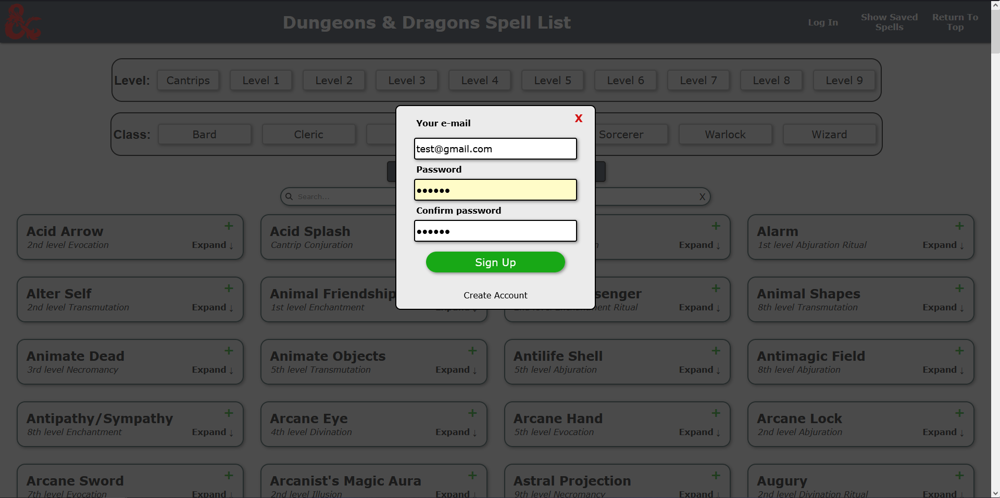
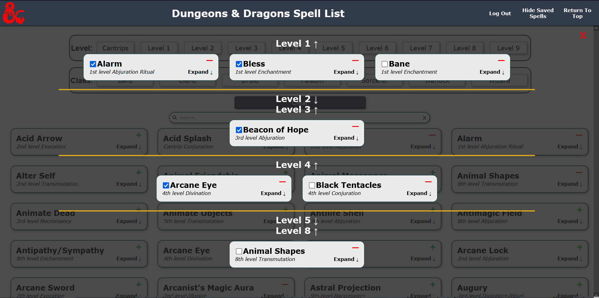
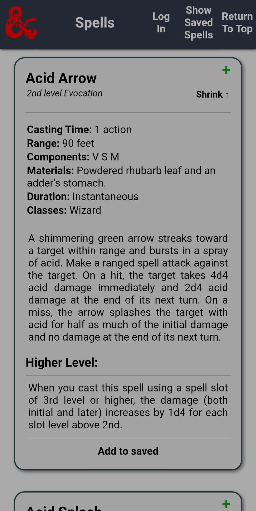
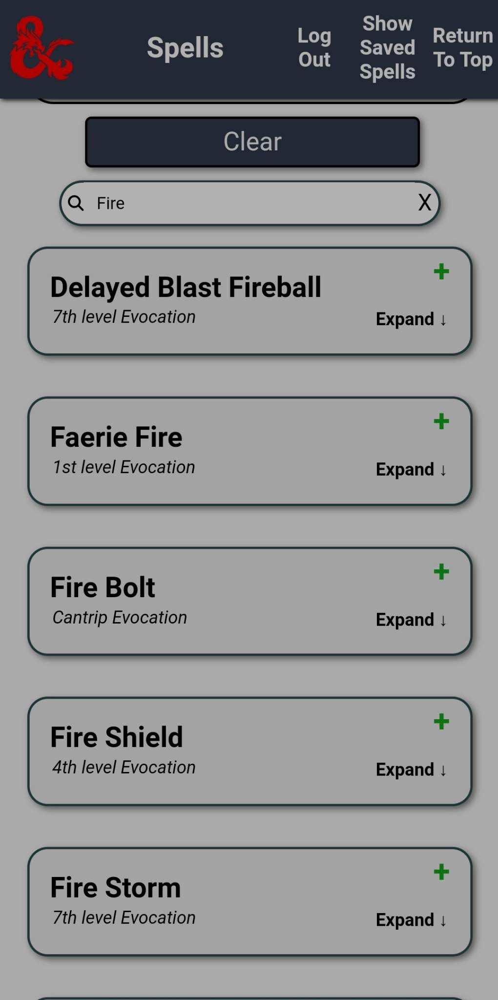
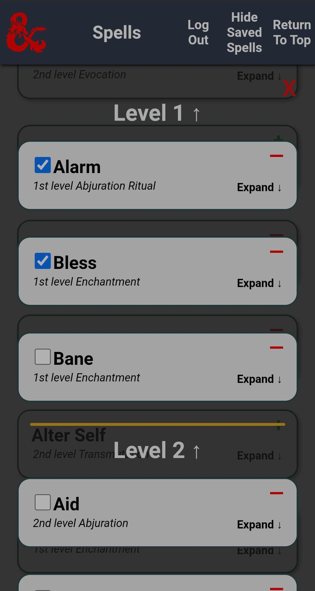

  <a href="https://henek123.github.io/dnd-spell-list/"><strong>Explore the website</strong></a>

<!-- ABOUT THE PROJEC -->
## About The Project

dnd-spell-list is a React website that fetches spell data from the D&D 5e 2024 REST API.
* The spell list loads when the page opens; full spell details load when a card is expanded.
* Spell details are cached in local storage for one month.
* Users can filter spells by level or class and search by name.
* Users can save spells during a session or sign in to save and synchronize saved and prepared spells with Firestore.

## Available Scripts

In the project directory, you can run:

### `npm start`

Runs the app in the development mode.
Open [http://localhost:3000](http://localhost:3000) to view it in your browser.

## Used Technologies

* JavaScript
* HTML
* CSS
* React
* D&D 5e 2024 REST API
* Axios
* Firebase Authentication
* Firebase Firestore

## Desktop view

## Mobile view
        

<!-- CONTACT -->
## Contact

Artur Bieniek
* e-mail: artur9724@gmail.com
* linkedIn: https://www.linkedin.com/in/artur-bieniek-8406a9245/

Project Link: [https://henek123.github.io/dnd-spell-list/](https://henek123.github.io/dnd-spell-list/)
