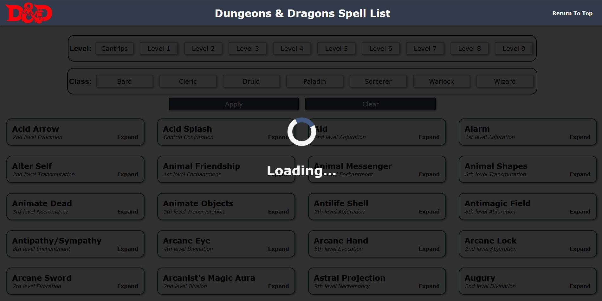

<p align="center">
  <a href="https://henek123.github.io/dnd-spell-list/"><strong>Explore the website</strong></a>
</p>

## About The Project

dnd-spell-list is a React app that fetches D&D 5e 2024 spell data from the D&D 5e API.

* Spells are sorted by level, then by name. Search by spell name or filter by level and class.
* Paladin cannot be combined with cantrips or spell levels 6–9.
* Spell details are fetched as cards approach the viewport and shown when expanded.
* Fetched spell details are cached in the browser's local storage for 30 days.
* Saved spells work for the current session without an account. Sign in to load and synchronize saved and prepared spells with Firebase Firestore.

## Setup

1. Install dependencies:

   ```sh
   npm install
   ```

2. Create a `.env` file in the project root and fill in the Firebase Web App configuration values from your Firebase project:

   ```env
   REACT_APP_API_KEY=your-api-key
   REACT_APP_AUTH_DOMAIN=your-project.firebaseapp.com
   REACT_APP_PROJECT_ID=your-project-id
   REACT_APP_STORAGE_BUCKET=your-project.appspot.com
   REACT_APP_MESSAGING_SENDER_ID=your-messaging-sender-id
   REACT_APP_APP_ID=your-app-id
   REACT_APP_MEASUREMENT_ID=your-measurement-id
   ```

   Enable Email/Password authentication and configure Firestore in that Firebase project to use account registration, sign-in, and cloud spell sync.

## Available Scripts

Run these commands from the project directory:

### `npm start`

Runs the app in the development mode.
Open [http://localhost:3000](http://localhost:3000) to view it in your browser.

### `npm test`

Runs the test suite.

### `npm run build`

Creates an optimized production build in the `build` directory.

## Used Technologies

* JavaScript
* HTML
* CSS
* React
* D&D 5e 2024 REST API
* Axios
* Firebase Authentication
* Firebase Firestore

## Desktop view



## Mobile view
        


<!-- CONTACT -->
## Contact

Artur Bieniek
* e-mail: artur9724@gmail.com
* linkedIn: https://www.linkedin.com/in/artur-bieniek-8406a9245/

Project Link: [https://henek123.github.io/dnd-spell-list/](https://henek123.github.io/dnd-spell-list/)
